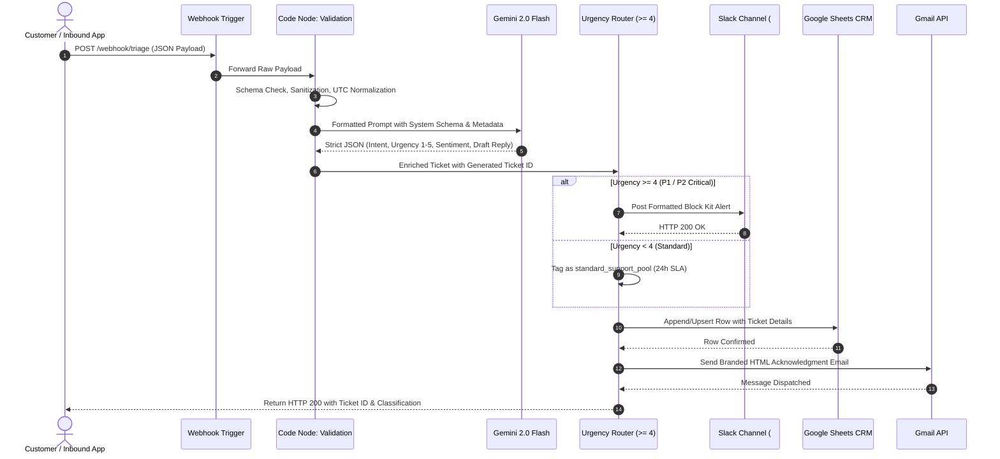

# System Architecture & Technical Specifications

## 1. Executive Summary

The **AI-Powered Customer Triage & Automated Dispatch Engine** is an event-driven automation pipeline built with **n8n** and **Google Gemini 2.0 Flash**. It replaces slow, error-prone manual ticket intake with sub-3-second automated triage, deterministic severity evaluation, instant team escalation, and personalized customer communication.

---

## 2. End-to-End Pipeline Data Flow



---

## 3. Component Breakdown

### 3.1 Ingestion & Preprocessing Layer
- **Trigger**: `POST /webhook/triage`
- **Validation Engine**: Node.js sandbox executing schema checks:
  - Required fields presence (`customer_id`, `email`, `subject`, `message`).
  - Regex RFC 5322 compliant email format validation.
  - Sanitization of message strings (truncation bounds to prevent token bombing).
  - Normalization of timestamps to ISO-8601 UTC.

### 3.2 AI Intelligence Layer (Google Gemini 2.0 Flash)
- **Model**: `gemini-2.0-flash`
- **Output Constraint**: `responseMimeType: "application/json"` with structured few-shot rubric.
- **Classification Schema**:
  ```json
  {
    "intent": "billing | technical_support | onboarding | urgent_bug | feature_request | account_management | general_inquiry",
    "urgency_score": 1,
    "sentiment": "positive | neutral | frustrated | angry | desperate",
    "entities": {
      "user_id": "string",
      "contact_info": "string",
      "issue_summary": "string",
      "product_area": "string",
      "mentioned_amounts": "string"
    },
    "drafted_reply": "string",
    "routing_reason": "string"
  }
  ```
- **Fallback Circuit Breaker**: If LLM output fails validation, the code node defaults gracefully to `urgency_score: 3` and flags for human audit rather than dropping the transaction.

### 3.3 Dynamic Routing & Dispatch Layer
- **Threshold Rule**: `Urgency Score >= 4`
- **Critical Path**:
  - Direct HTTP webhook push to team Slack `#urgent-escalations` channel with interactive Block Kit UI.
  - Customer metadata (MRR, account age) highlighted for priority handling.
- **Standard Path**:
  - Tagged into normal pool with SLA standard expectation (24h).

### 3.4 Persistence & Audit CRM Layer
- **Storage Target**: Google Sheets (or PostgreSQL / Supabase in enterprise profile).
- **Primary Key**: `ticket_id` format: `TRIAGE-YYYYMMDD-XXXX`.
- **Indexed Attributes**: Timestamp, Customer ID, Intent, Urgency, Sentiment, Routing Reason, Dispatched Via.

### 3.5 Outbound Communication Layer
- **Dispatch**: Gmail OAuth2 API.
- **Template**: Responsive HTML email with personalized greeting, AI-crafted acknowledgment addressing the specific inquiry, and transparent tracking metadata.

---

## 4. Error Handling & Reliability Strategy

| Failure Scenario | Mitigation Strategy |
|---|---|
| **Malformed Inbound Payload** | Validation node throws explicit HTTP 400 error before LLM invocation, preventing downstream token costs. |
| **LLM Rate Limit / API Quota** | Fallback catch logic assigns `Urgency: 3` (Medium), creates the ticket, and alerts the monitoring queue. |
| **Slack Webhook Outage** | n8n node configured with automatic retry (3 attempts with exponential backoff). |
| **Google Sheets OAuth Expiry** | n8n credential auto-refresh token handling; errors flagged in n8n execution history. |

